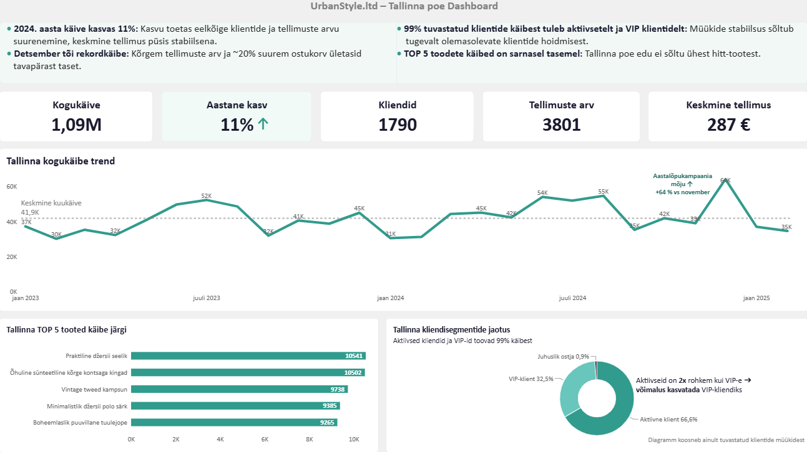

# Nele Kund | DACA Portfolio

Tere tulemast minu andmeanalüüsi portfooliosse!

Siin jagan oma andmeanalüüsiga seotud projekte nädalate kaupa. DACA portfoolio olen üles ehitanud alates SQL-päringutest ja andmete puhastamisest kuni interaktiivsete dashboardide ja Pythoniga tehtud analüüsideni.

 

 

📈 **Data Analyst Career Accelerator (DACA)**  
📅 **Algus: 11.08.2026**

---

## Minust

Mind huvitab andmeanalüüsi tervikprotsess – andmete töötlemine usaldusväärseks analüüsimiseks, mustrite avastamine ning visualiseerimine andmeloo esitlemiseks. Samuti olen juurde õppimas oskusi automatiseerimises, et vähendada korduvat käsitsi tehtavat tööd ning muuta andmetega töötamine kiiremaks ja tõhusamaks.

Minu DACA portfoolio keskendub kolmele valdkonnale:

- 🔍 **Data Analysis** – andmete uurimine, puhastamine ja analüüsimine
- 🖼️ **Data Visualization** – dashboardid, KPI-d ja visuaalne andmelugu
- 🤝 **Business Insights** – tulemuste tõlgendamine ja äriliste otsuste toetamine

---

## Tehnoloogiad ja tööriistad

| Valdkond | Oskused |
|---|---|
| **Data Analysis** | SQL, pandas, Data Cleaning, RFM |
| **Databases** | PostgreSQL, Supabase |
| **Data Visualization** | Power BI, Dashboard Design |
| **Business Intelligence** | KPI Analysis, Data Storytelling |
| **Development Tools** | Git, GitHub, VS Code, Jupyter Notebook |

---

## Projektid

Minu DACA projektid põhinevad fiktiivse **UrbanStyle'i jaekaubandusettevõtte andmetel** ning käsitlevad ärilisi probleeme, millega ettevõte kiire kasvu tõttu silmitsi seisab.

### 🛢️ SQL | Data Exploration & Analysis

| Nädal | Projekt | Tulemus |
|---|---|---|
| [Week 0](week-0/) | Onboarding | Analüüsikeskkondade seadistamine |
| [Week 1](week-1/) | SQL Basics | Müügiandmete esmane ülevaade |
| [Week 2](week-2/) | SQL Cleaning | Kliendiandmete kvaliteedianalüüs |
| [Week 3](week-3/) | SQL JOINs | Tootekategooriate ja laoseisu analüüs |
| [Week 4](week-4/) | SQL Aggregation | Käibekasvu ja müügitrendide analüüs |

### 🖼️ Power BI | Visualization & Storytelling

| Nädal | Projekt | Tulemus |
|---|---|---|
| [Week 5](week-5/) | Visualization Design | Sidusrühmade ja investori juhtimislauad |
| [Week 6](week-6/) | Data Storytelling | Interaktiivsed dashboardid ja ärijäreldused |

### 🐍 Python | Data Analytics

| Nädal | Projekt | Tulemus |
|---|---|---|
| [Week 7](week-7/) | Python pandas | Klientide RFM-analüüs |
| [Week 8](week-8/) | Python APIs | Tiimitööna automatiseeritud müügianalüüs, Plotly visualiseeringud ja tulemuste eksport |

### 🚀 Career | Portfolio Presentation

| Nädal | Projekt | Tulemus |
|---|---|---|
| [Week 9](week-9/) | Career Preparation | Värbamisjuhendi koostamine |
| [Week 10](week-10/) | Portfolio Presentation | Analüüsitulemuste koondamine ja meeskonna lõpuprojekt | 

---

## Esiletõstetud projektid

### 📈 UrbanStyle | Sales Performance Analysis

**SQL · PostgreSQL · Business Analytics**

UrbanStyle'i müügitulemuste analüüs, mille eesmärk oli hinnata käibekasvu, tuvastada müügitrende ning võrrelda tootekategooriate tulemuslikkust.

**Analüüsi fookus:**

- Kahe aasta käibekasvu võrdlus
- Kuust-kuusse kasvuprotsendid ja müügitrendid
- Tootekategooriate populaarsus
- Müümata toodete tuvastamine

🔗 **[Tutvu SQL-projektidega](week-4/)**

### 📶 UrbanStyle | Interactive Dashboards

**Power BI · Dashboard Design · Data Storytelling**

Erinevatele sidusrühmadele mõeldud juhtimislauad, mis aitavad mõista, kuidas UrbanStyle'il müügitulemuste osas läheb ning toetada edaspidiseid andmepõhiseid otsuseid.

**Projekti fookus:**

- KPI-de visualiseerimine
- Sidusrühmade vajadustest lähtuv visuaal
- Interaktiivsed vaated
- Andmelood ja ärilised järeldused

🔗 **[Tutvu dashboardi projektiga](week-6/)**

 

**📍Tallinna pood | Populaarseima müügiasukoha andmelugu**

### 🐍 UrbanStyle | Customer RFM Analysis

**Python · pandas · Customer Analytics**

UrbanStyle'i klientide ostukäitumise analüüs RFM-meetodil.

**Analüüsi fookus:**

- Recency – kui hiljuti ostis?
- Frequency – kui tihti ostab?
- Monetary – kui palju kulutab?

🔗 **[Tutvu RFM-projektiga](week-7/)**

---

## Minu õpiteekond

DACA programmi jooksul olen arendanud nii tehnilisi oskusi kui ka analüütilist mõtlemist.

Suurimad õppetunnid ei ole minu jaoks olnud ainult tehnilise koodi kirjutamine või diagrammide loomine, vaid oluline on olnud mõista:

**Millisele küsimusele me tegelikult vastust otsime?**  
**Mida andmed näitavad?**  
**Mida on võimalik teadmistega edasi teha?**

---

## 📩 Kontakt

  

