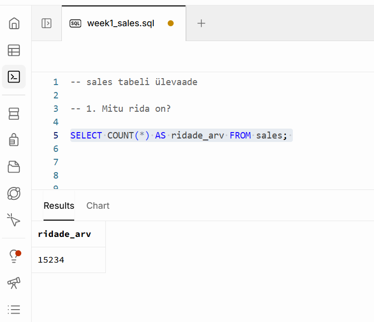
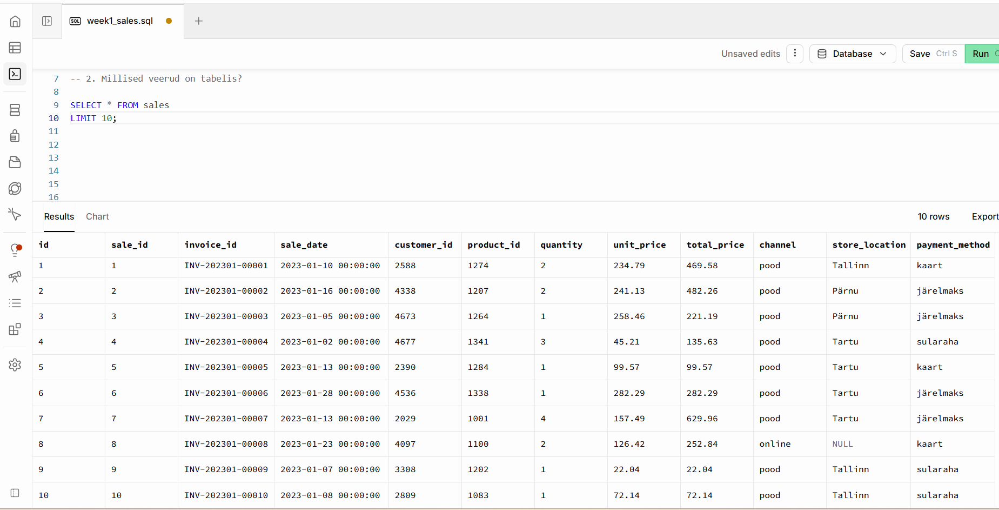
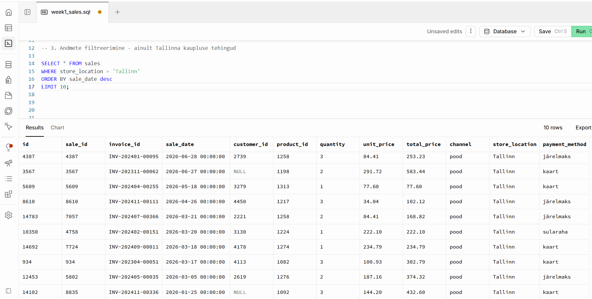
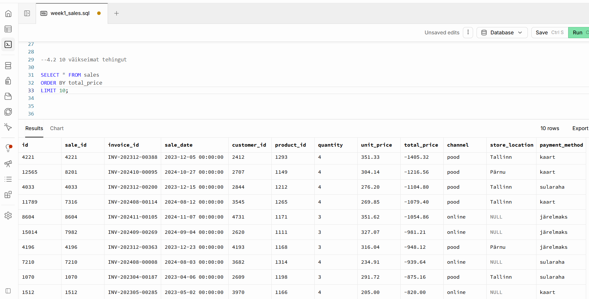
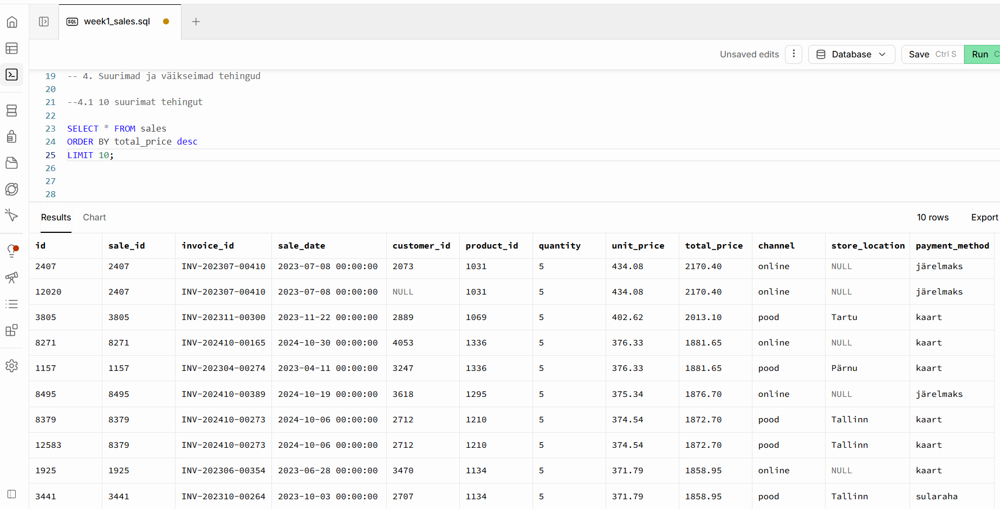
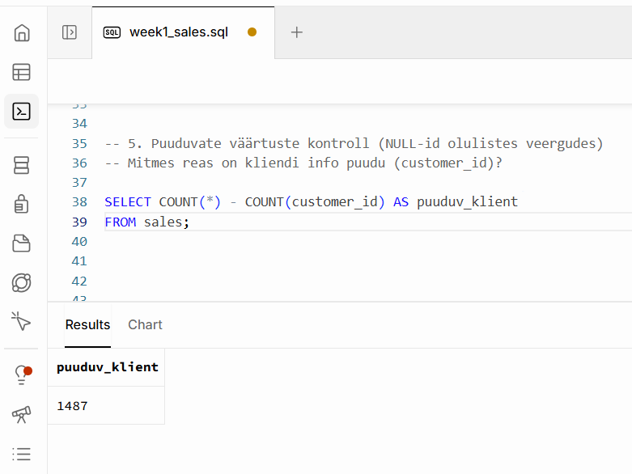

# Week 1: SQL Basics
## 📊 Sales Data Explorer

**Meeskond:** Sales Analytics  
**Roll:** A – Sales Data Explorer  
**Andmeallikas:** ´sales tabel´ (Supabase)  
**Link grupitööle:** [GitHub Sales Analytics](https://github.com/andres-assukyll/urbanstyle-sales-analytics/blob/main/week1/README.md)

## Probleem

Jaekaubandusettevõtet UrbanStyle iseloomustab **ülikiire kasv**. Neil on olemas mahukad andmed **müükide, klientide, toodete** kohta, kuid neid pole seni põhjalikult analüüsitud. Et aga saada ettevõtte tegelikest olukorrast ülevaade, peame esmalt nägema, **millises seisus on andmed**.

## 1. Ridade arv sales tabelis

## 2. Veergude arv sales tabelis

## 3. Tallinna kaupluse tehingud

## 4. 10 väikseimat tehingut

## 5. 10 suurimat tehingut

## 6. Müügiread, kus kliendiinfo puudub (NULL-id)

## 📌 Kokkuvõte

| Näitaja | Tulemus |
|---|---:|
| Ridu | 15 234 |
| Veergusid | 12 |
| Suurim tehing | 2 170,40 |
| Väikseim tehing | -1 405,32 |
| Puuduv kliendiinfo | 1 487 (~9,76%) |

## 🔎 Mis oli üllatav?

Andmestikus esineb negatiivseid tehinguid.

> Kas tegemist on tagastustega?  
> Kuidas arvestada neid edasises analüüsis?

## 💡 Järeldused

Sales tabel annab hea aluse edasiseks andmeanalüüsiks, kuid enne tuleks selgitada:
- negatiivsete tehingute tähendus;
- puuduva kliendiinfo põhjus.
