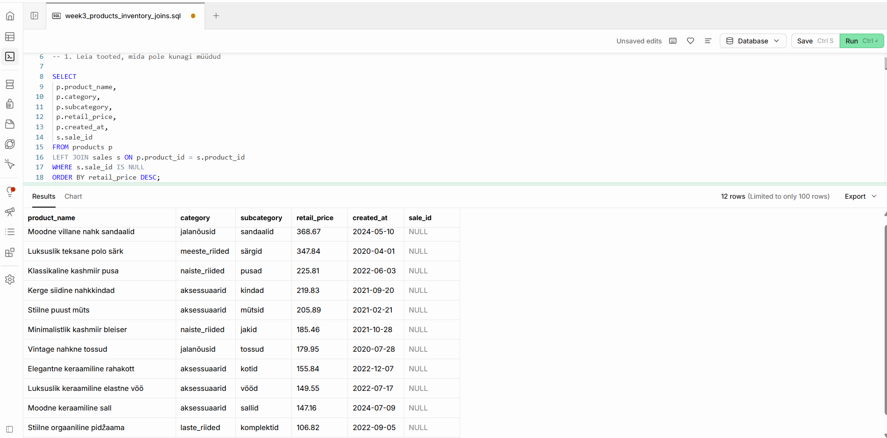
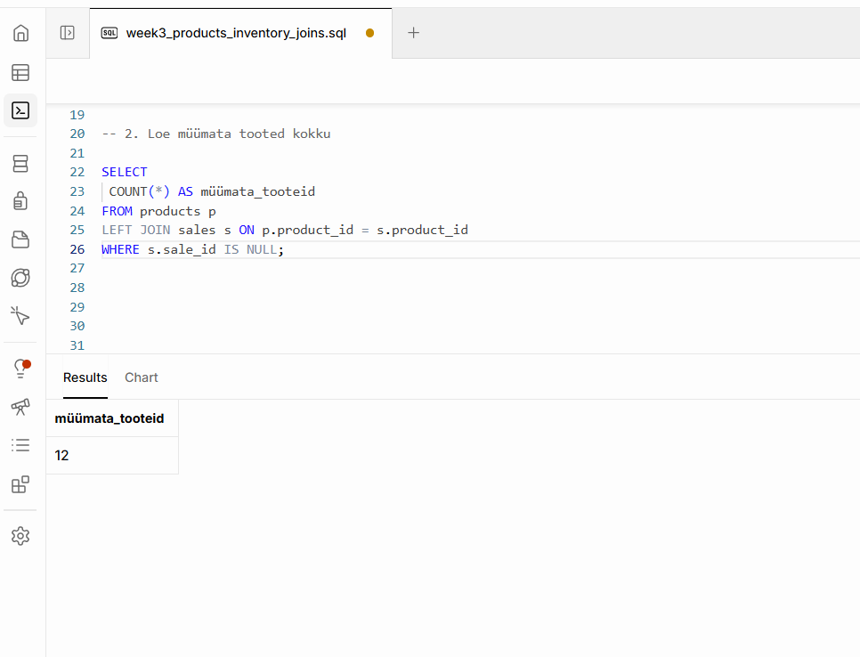
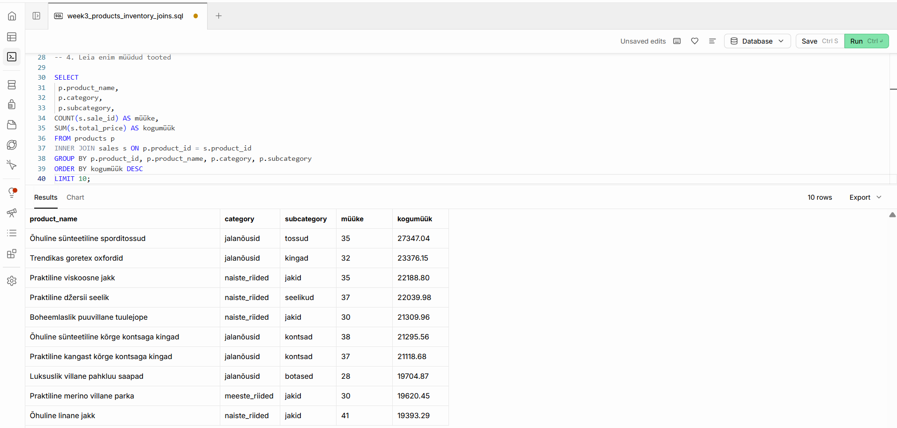
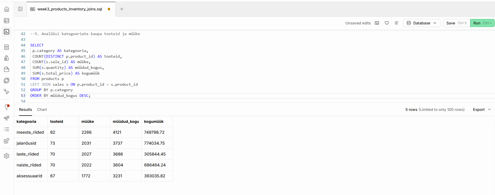
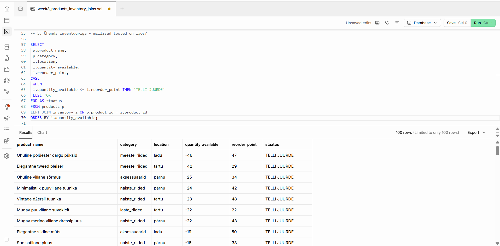
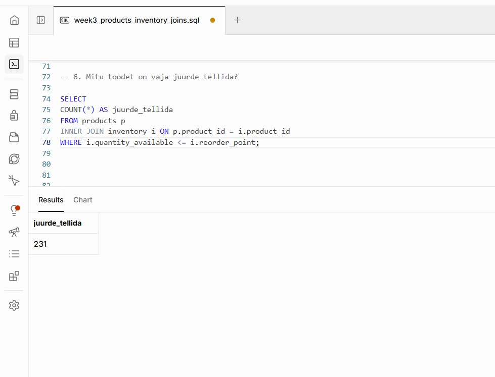
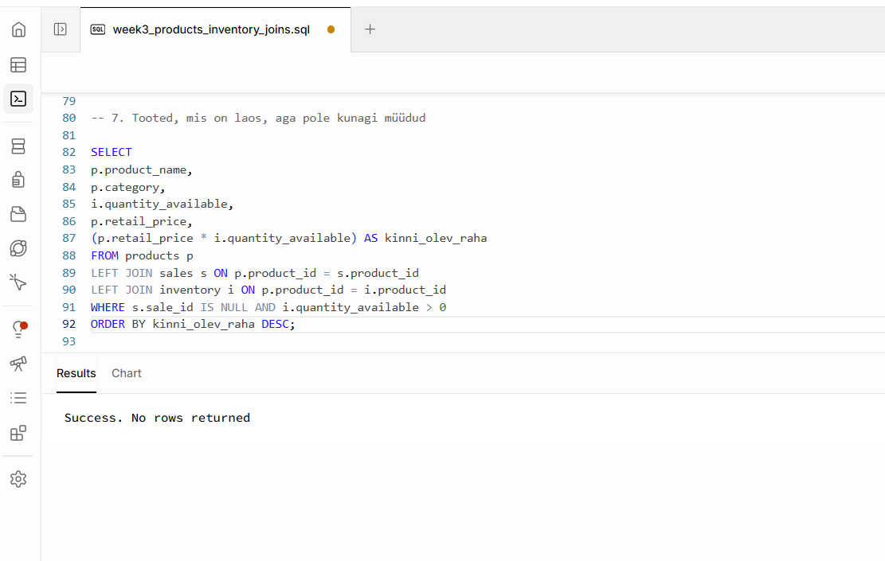
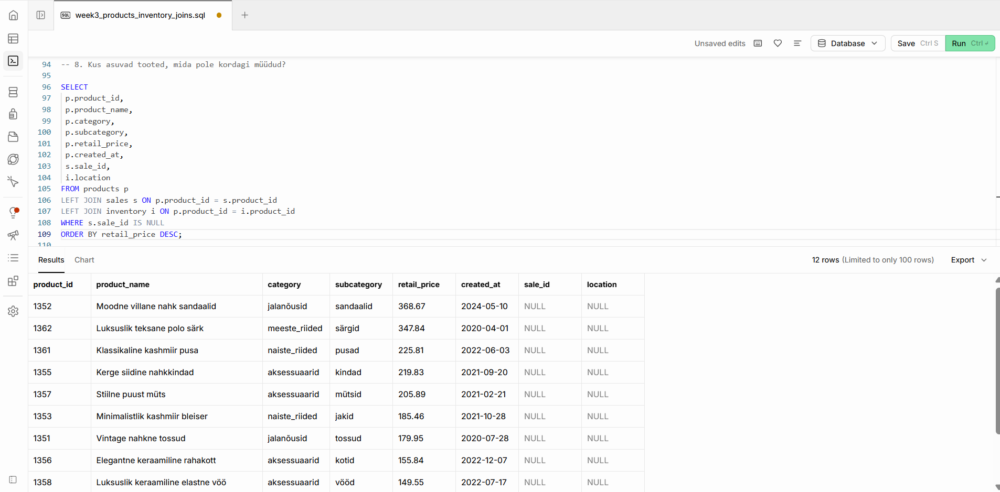

# Week 3: SQL JOINs

## 📝 Ülesanne: Aidata vastata Urbanstyle ettevõtte ärilistele küsimustele, mis nõuavad mitme andmetabeli omavahel ühendamist.

**Nimi:** Nele Kund   
**Meeskond:** Sales Analytics    
**Roll:** C – Müümata toodete ja inventuuri analüüs   
**Andmeallikad:** `products` , `sales`, `inventory` tabelid (Supabase)  
**Link grupitööle:** [GitHub Sales Analytics Week 3](https://github.com/andres-assukyll/urbanstyle-sales-analytics/blob/main/week3/README.md)  

## Toodete ja inventuuri analüüsi tulemused

### 1. Tooted, mida pole kunagi müüdud

### 2. Müümata toodete arv

### 3. Enim müüdud tooted

### 4. Tooted ja müügid kategooriate kaupa

### 5. Laos olevate toodete ülevaade

### 6. Juurdetellimist vajavad tooted

### 7. Tooted, mis on laos, kuid mida pole kordagi müüdud

### 📁 Individuaalne töö

- [SQL päringud](week3_products_inventory_joins.sql)
- [Kokkuvõte ja inventuuri soovitused](week3_inventory_recommendations.md)

