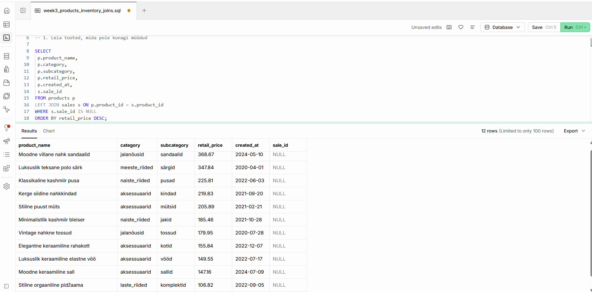
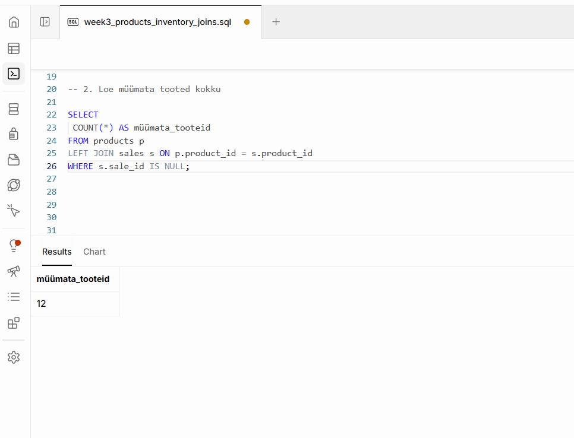
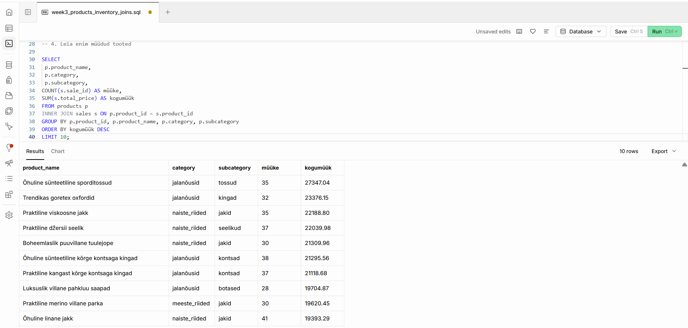
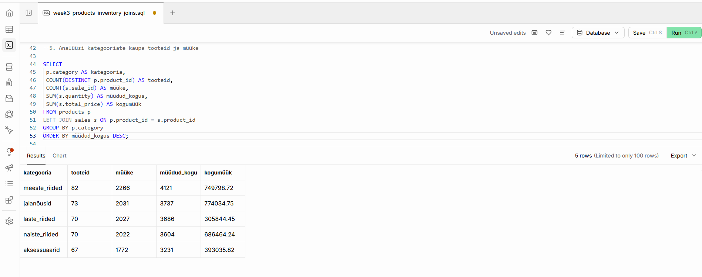
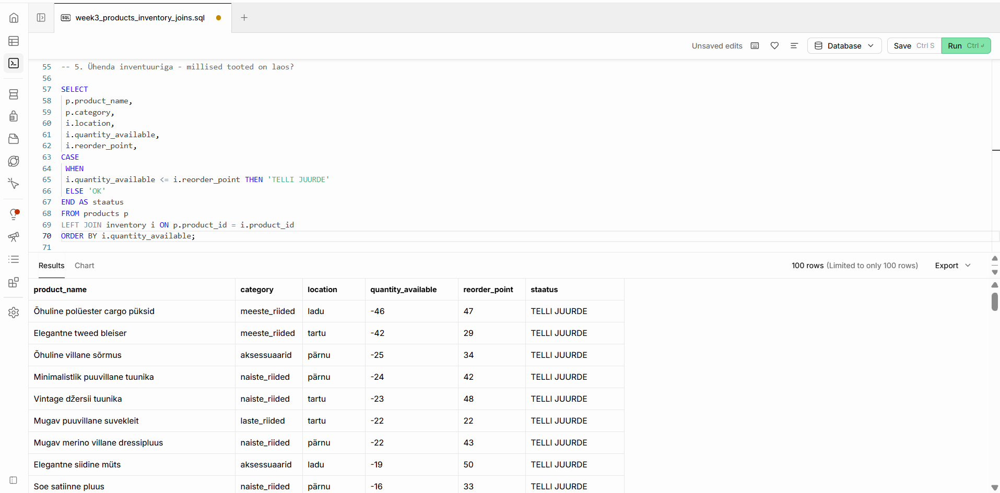
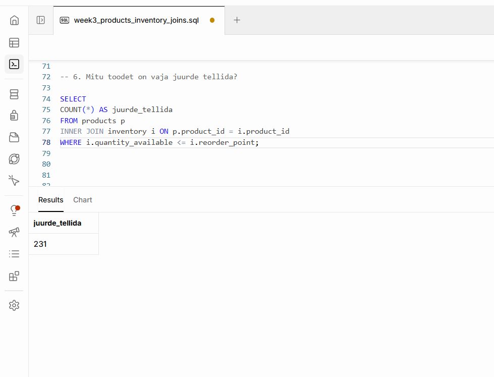
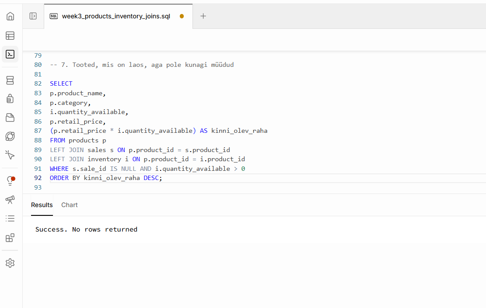
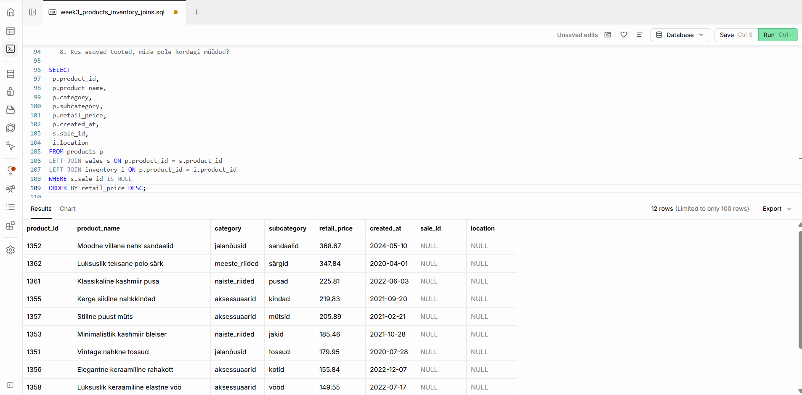

# Week 3: SQL JOINs

**Nimi:** Nele Kund   
**Meeskond:** Sales Analytics    
**Roll:** C – Müümata toodete ja inventuuri analüüs   
**Andmeallikad:** `products` , `sales`, `inventory` tabelid (Supabase)  
**Link grupitööle:** [GitHub Sales Analytics Week 3](https://github.com/andres-assukyll/urbanstyle-sales-analytics/blob/main/week3/README.md)  

## Probleem

UrbanStyle'il on puudulik ülevaade laoseisust, populaarsetest toodetest ning ka sellistest toodetest, mida pole kordagi ostetud. Ettevõttele on selline info väga oluline, sest ebapiisavad laovarud võivad põhjustada olukorra, kus nõutud tooted ei pruugi olla klientidele tagatud. Täpne laoseisude analüüs võimaldab paremini planeerida toodete juurdetellimisi ja ka varusid efektiivsemalt hallata.

## Toodete ja inventuuri analüüsi tulemused

### 1. Tooted, mida pole kunagi müüdud

### 2. Müümata toodete arv

### 3. Enim müüdud tooted

### 4. Tooted ja müügid kategooriate kaupa

### 5. Laos olevate toodete ülevaade

### 6. Juurdetellimist vajavad tooted

### 7. Tooted, mis on laos, kuid mida pole kordagi müüdud

## 📁 Individuaalne töö

- [SQL päringud](week3_products_inventory_joins.sql)

## 📦 Kokkuvõte ja inventuuri soovitused

### 🔝 Populaarsus vs kogumüük

| Kategooria | Müüdud kogus (tk) | Kogumüük (€) |
|:---:|:---:|:---:|
| 🥇 Meeste riided | **4 121** | **749 798.72** |
| 🥈 Jalanõud | **3 737** | **774 034.75** |
| 🥉 Lasteriided | **3 686** | **305 844.45** |
| 👗 Naiste riided | **3604** | **686 464.24** |
| 💍 Aksessuaarid | **3231** | **393 035.82** |

*⚠️ Tähelepanek: Turundusfookus hoida ka naisteriietel, sest sarnase müüdud koguse juures on nende käive üle **2x** suurem kui lasteriietel!*

✔ Inventuuri planeerimisel **prioritiseerida meeste riiete, jalanõude ja naiste riiete** laoseisu ja saadavust, sest need moodustavad kokku **~76%** käibest. 
 

### 🚨 Müümata tooted

❗ Kokku on **12** müümata toodet - neid pole kordagi ostetud ega inventuuri tabelisse lisatud. Lisaks selgus, et tegemist on duplikaatsete toodetega, mis tuleks segaduse vältimiseks `products` tabelist eemaldada.
 

### 🚚 Laoseis

🚩 **231** toodet vajab juurdetellimist.  
*Soovitatav tähtsuse järjekord toodete saadavuse põhjal* :   
     **KRIITILINE:** Laoseis negatiivne ➜ **KÕRGE:** Laoseis 0 ➜ **KESKMINE:** Positiivne, kuid ebapiisav laoseis.     

 

 Vaata lisainfot 
     
 
➕ Tooteid, mis on laos ja pole kordagi müüdud <strong>ei ole!</strong> See kinnitas täiendavalt, et 12 müümata toodet ei ole laosüsteemiga seotud.
