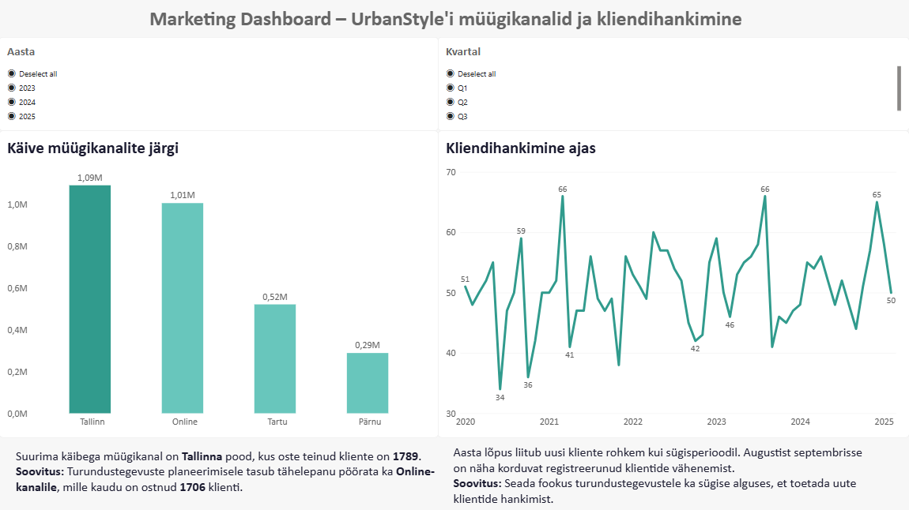
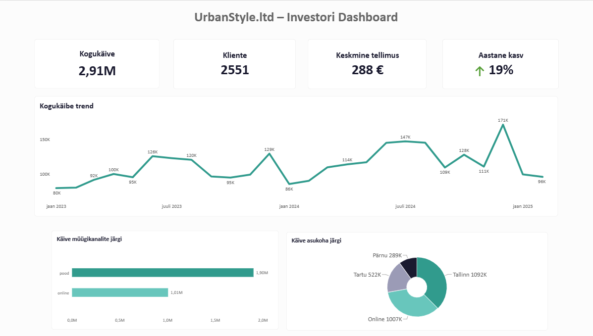

# Week 5: Visualisation Design

**Nimi:** Nele Kund   
**Meeskond:** Sales Analytics    
**Roll:** B – Marketing + Koondvaade  
**Andmeallikad:** `sales`, `customers` tabelid (Supabase)  
**Link grupitööle:** [GitHub Sales Analytics Week 5](https://github.com/andres-assukyll/urbanstyle-sales-analytics/blob/main/week5/README.md)

## Turunduse Dashboard

## Dashboard'i koondvaade

### 📁 Individuaalne töö
- [SQL päringud](week5_marketing_dashboard.sql)

### ֎🇦🇮 kasutamine

- DAX valemite koostamine Power BI-s 
- Visualiseerimisel tekkinud vigade parandamiseks
- Täiendavate selgituste saamiseks diagrammide vormingu seadistuste kohta