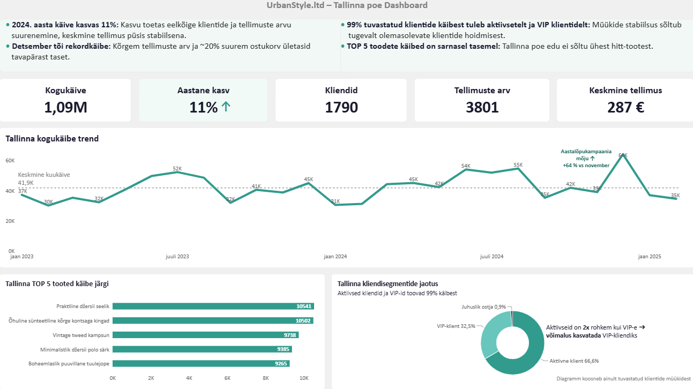
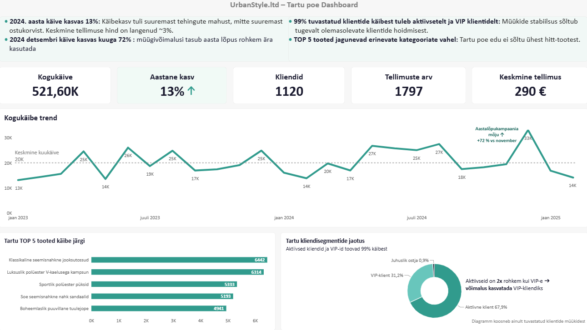

# Week 5: Visualisation Data

**Nimi:** Nele Kund   
**Meeskond:** Sales Analytics    
**Roll:** A – Tallinna kauplus + Tartu kauplus  
**Andmeallikad:** `sales`, `customers`, `products` tabelid

## Probleem

Nädal varem loodud juhtimislauad ehk *dashboard*-id on üldised ja vajavad esitlemiseks läbimõeldud andmelugu - mis toimub Tallinna ja Tartu kauplustes, millised on konkreetsed mõõdikud, tugevused ja mustrid? Dashboard koos narratiiviga annab kuulajale selge andmepõhise sõnumi ning aitab ettevõttel saadud järelduste põhjal  järgmisi äritegevusi planeerida.

## Tallinna poe dashboard

### 💡 Tallinna poe andmelugu
 

Tallinna pood on UrbanStyle'i suurim müügikanal. 2024. aastal kasvas poe käive **11%** - seda toetasid tellimuste mahu suurenemine, kliendibaasi kasvatamine ning **detsembrikuu rekordmüük (~64 000 €)**. Soovitame järgida detsembrikuu edu tagamiseks samasugust kampaaniamudelit ja toetada aktiivsete klientide arenemist VIP-klientideks personaalsete pakkumiste abil.

## Tartu poe dashboard

### 🔎 Tartu poe andmelugu
 

Tartu pood on UrbanStyle'i müügikanal, mis on kogukäibelt **3. kohal**. 2024. aastal kasvas poe käive **13%** - kasv on isegi suurem kui Tallinna kauplusel. Edukas detsembrikuu toetas kasvu ja tõi Tartu poele novembrikuuga võrreldes lausa **72%** rohkem käivet. Kuna detsember tõi väga tugeva käibekasvu, soovitame kindlasti varasemat kampaaniamudelit ka järgmistel aastatel rakendada ja hoida juba olemasolevaid kliente, kelle osakaal kliendibaasist on **99%**.

